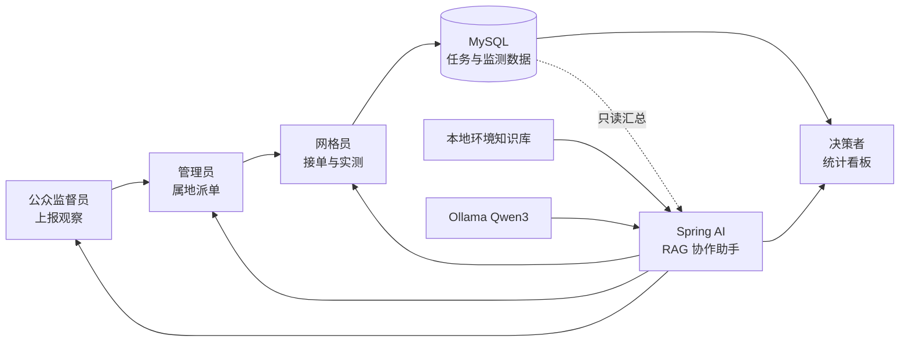

# NEPS 环保公众监督与智能研判系统

NEPS 是一个可完整演示“公众上报 → 管理员派单 → 网格员现场检测 → 决策统计”的环保公众监督平台。项目在原需求基础上增加了本地 RAG 智能助手、角色化数据研判、可解释风险预评分、任务时限和人员增配闭环，适合作为 Java 全栈与 AI 应用方向的求职作品集。

## 项目亮点

- 四端一体：公众监督员、AQI 检测网格员、系统管理员、环境决策者共用一套权限和任务状态机。
- 本地 AI：Spring AI 对接 Ollama/Qwen3，不需要把业务数据发送到第三方云端。
- 可解释 RAG：先从内置环境知识库检索，再注入当前角色可见的只读统计上下文，回答会区分“公众观察、系统统计、仪器实测、执法认定”。
- 多轮与降级：对话记忆只保存在服务会话内；模型离线或超时时自动返回本地知识库结果。
- 风险预研判：根据人员不适、黑烟、异味、敏感场所和异常时段给出可解释评分、派单等级和证据清单。
- 可复现运行：首次连接一个空的 `neps_environment` 数据库时，应用会自动创建表、导入全国省市和演示数据。
- 工程能力：BCrypt 密码迁移、RSA 登录传输、角色鉴权、登录审计、OpenAPI、Actuator、Maven Wrapper、前后端生产构建和测试。

## 技术栈

| 层 | 技术 |
| --- | --- |
| 前端 | Vue 3、Vue Router、Vuex、Element Plus、Axios |
| 后端 | Java 17、Spring Boot 3.2、Spring AI 1.0、MyBatis Plus、JdbcTemplate |
| 数据与 AI | MySQL 8、Ollama、Qwen3、本地 Markdown 检索知识库 |
| 工程化 | Maven Wrapper、npm lockfile、Docker Compose、Swagger UI、Actuator |

## 架构与业务流



## 在 IDEA 中启动

### 1. 准备环境

- JDK 17
- Node.js 18 或更高版本
- MySQL 8 或 Docker Desktop
- 可选：Ollama 与 `qwen3:1.7b`。不安装也能使用知识库降级回答和风险预研判。

如果本机已有 MySQL，只需先创建空数据库：

```sql
CREATE DATABASE neps_environment CHARACTER SET utf8mb4 COLLATE utf8mb4_unicode_ci;
```

也可以使用项目自带容器，端口特意设置为 3307，避免和本机 MySQL 冲突：

```powershell
docker compose up -d mysql
$env:NEPS_DB_URL='jdbc:mysql://localhost:3307/neps_environment?serverTimezone=Asia/Shanghai&useUnicode=true&characterEncoding=utf-8&allowMultiQueries=true&useSSL=false&allowPublicKeyRetrieval=true'
$env:NEPS_DB_PASSWORD='neps_dev_password'
```

使用本机 MySQL 时，在 IDEA 的后端运行配置中至少填写：

```text
NEPS_DB_PASSWORD=你的 MySQL root 密码
```

数据库账号不是 `root` 时，再增加 `NEPS_DB_USERNAME`。数据库连接串需要调整时使用 `NEPS_DB_URL`。

### 2. 启动本地模型 可选

```powershell
ollama pull qwen3:1.7b
ollama serve
```

可以通过 `NEPS_AI_MODEL` 更换任意 Ollama 中已安装、支持 OpenAI 兼容接口的模型。

### 3. 导入并运行

1. IDEA 选择 **Open**，打开本仓库根目录。
2. 等待 IDEA 导入根 `pom.xml` 和 `backend` Maven 模块，项目 SDK 选择 JDK 17。
3. 在 `NEPS Backend` 运行配置中加入 `NEPS_DB_PASSWORD`，然后运行该配置；也可以直接运行 `DemoApplication.java`。
4. 第一次运行前端，在 IDEA Terminal 执行 `cd frontend` 和 `npm ci`。
5. 运行项目自带的 `NEPS Frontend` 配置，或点击 `frontend/package.json` 中的 `serve` 脚本，访问 `http://localhost:8080`。

也可以直接使用命令：

```powershell
cd backend
.\mvnw.cmd spring-boot:run

# 另开终端
cd frontend
npm ci
npm run serve
```

启动前可运行 `powershell -ExecutionPolicy Bypass -File .\scripts\preflight.ps1` 检查端口和环境。

## 演示账号

| 角色 | 账号 | 密码 |
| --- | --- | --- |
| 公众监督员 | `13800000000` | `123456` |
| AQI 检测网格员 | `GRID001` | `123456` |
| 系统管理员 | `admin` | `123456` |
| 决策者 | `decision` | `123456` |

公众监督员也可以从注册页面创建新账号。演示密码只用于本地项目，部署前必须更换。

## AI 设计说明

智能助手不是单纯把问题转发给模型，而是执行以下流程：

1. 根据问题从 `backend/src/main/resources/ai/environment-knowledge.md` 检索最相关主题。
2. 读取反馈总量、处理状态和实测污染概况等聚合数据，不读取或输出个人明细。
3. 按公众、网格员、管理员、决策者注入不同回答约束。
4. 带入当前会话最近若干轮问答并流式输出。
5. Ollama 超时或不可用时返回最相关的知识库条目。

`风险预研判` 使用确定性规则产生 0–100 分，并返回所有命中原因，便于答辩时说明为什么该结果可审计。它只用于派单优先级辅助，不替代仪器实测、执法或医疗判断。

## 构建与测试

```powershell
cd backend
.\mvnw.cmd test

cd ..\frontend
$env:NODE_OPTIONS='--max-old-space-size=1536'
npm run build
```

Swagger UI：`http://localhost:9000/swagger-ui.html`  
健康检查：`http://localhost:9000/actuator/health`

## 上传到 GitHub

项目已包含 `.gitignore`，不会提交数据库密码、`node_modules`、构建产物和 IDEA 本地文件。

```powershell
git add .
git commit -m "feat: build NEPS environmental supervision platform"
git remote add origin https://github.com/你的用户名/你的仓库名.git
git push -u origin main
```

仓库名称建议使用 `neps-environmental-supervision`。上传前请检查 Git 状态，确认没有本机密码、日志或个人信息。

## 面试讲解建议

- 先用四类角色演示完整任务闭环，再展示管理员调度和决策统计。
- AI 部分重点说明“本地部署、检索增强、角色上下文、故障降级、可解释评分”，比只调用聊天接口更能体现工程思考。
- 数据设计重点说明任务状态、属地派单、接单时限、最终实测和统计口径。
- 安全部分重点说明 RSA 传输、BCrypt、服务端 Session、角色拦截器和登录审计。

## 免责声明

本项目用于学习、课程展示和求职作品集。系统中的演示数据与 AI 输出不用于真实环境执法、医疗诊断或应急指挥。
